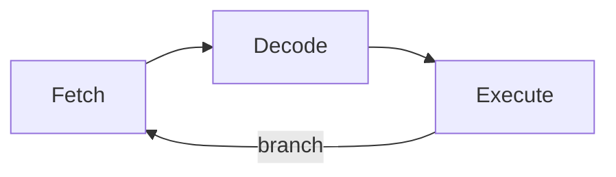
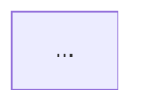

# Content guide

Everything about the site's content lives in two places:

- **`content/`**: the pages. Every folder with an `index.md` inside is a page.
- **`site.config.yaml`**: the home page title and intro, the contact links, the wordmark
  at the top of the sidebar, and the fonts.

You never need to touch anything in `src/` to add or change content. If something here
doesn't work as described, that's a bug, not something you're doing wrong.

**Contents:**

- [Editing on github.com](#editing-on-githubcom-no-setup)
- [Pages and categories](#pages-and-categories)
- [Frontmatter](#frontmatter-the-settings-at-the-top-of-a-page)
- [Banners](#banners)
- [Cards](#cards)
- [The home page](#the-home-page)
- [Fonts](#fonts)
- [Colours, themes and the settings button (every site)](#colours-themes-and-the-settings-button-every-site)
- [Markdown](#markdown)
- [The typing animation](#the-typing-animation)
- [Previewing on your computer](#previewing-on-your-computer)
- [When the build fails](#when-the-build-fails)

---

## Editing on github.com (no setup)

You can do everything from the browser.

**Edit a page:** open the file on GitHub (for example `content/projects/index.md`),
click the pencil icon, make your change and click **Commit changes**.

**Add a page:** in the repository, click **Add file → Create new file** and type the
whole path as the name, slashes included:

```
content/projects/my-new-thing/index.md
```

GitHub creates the folders for you. Paste in a starting point such as:

```md
---
title: My New Thing
description: One line about it, shown on cards.
---

What it is, how I built it, what I learned.
```

**Add images:** open the page's folder on GitHub (for example
`content/projects/my-new-thing/`), click **Add file → Upload files** and drop them in.
Name the header image `banner.jpg` (or `.png`, `.webp`, `.avif`) and it's picked up
automatically.

**Publish:** committing to `main` starts the deploy. Open the **Actions** tab to watch
it. A green tick means the site is live about a minute later. A red cross means
something needs fixing and the old version stays up (see
[When the build fails](#when-the-build-fails)).

To check a big change before it goes live, choose **Create a new branch and start a pull
request** when you commit. The same checks run on the pull request without publishing,
and you merge it when it's green.

---

## Pages and categories

The folder structure *is* the site. Folder paths become web addresses, and the sidebar
tree is built from the folders:

```
content/
  home.md                     extra content under the intro on the home page (optional)
  projects/
    index.md                  → /projects/
    banner.jpg
    nand-alu/
      index.md                → /projects/nand-alu/
      settle.svg              images sit next to the page that uses them
  tools/
    index.md                  → /tools/
    prereqflow-notes/
      index.md                → /tools/prereqflow-notes/
```

- **A page** is a folder with an `index.md` inside.
- **A category** is just a page with sub-folders. Its sub-pages are listed at the bottom
  as cards, and it gets a folder arrow in the sidebar. Nest as deep as you like. The
  first card of a set is drawn wide, the rest two to a row.
- **Section headings** (`##`) hang in a column to the left of the text on wide screens,
  like a manual; pages without them keep one left edge. Smaller headings (`###`) stay
  in the text.
- **The sidebar** collapses to a narrow rail with its arrow button, and remembers that.
  Tablets start with the rail; on phones it's a bar along the top whose menu button opens
  the page tree over the page.
- **Folder names** become web addresses, so they must be lowercase words with hyphens:
  `nand-alu`, not `NAND ALU` or `nand_alu`. The `title` in the
  frontmatter is what people see.
- **Reserved names:** `prereqflow`, `otucalendar` and `satisfactorytools` can't be top-level folders, because
  those addresses already belong to those sites. They're listed under `reservedSlugs`
  in `site.config.yaml`. `fonts`, `icons`, `design` and `js` are used by the site itself.

### The quick way (on your computer)

```sh
npm run new -- projects/my-new-thing "My New Thing"
```

This creates `content/projects/my-new-thing/index.md` with every optional setting listed
and commented out. It refuses reserved names, folders that already exist, names that
aren't lowercase-with-hyphens, and pages whose parent page doesn't exist yet.

### Adding a category

Make a folder with an `index.md`, then put page folders inside it:

```sh
npm run new -- audio "Audio DSP"
npm run new -- audio/fir-filter "FIR filter on an FPGA"
```

Then set `order` on the categories so they sit where you want in the sidebar (see below).

### Order, hidden pages and drafts

- **`order: 10`** puts a page before siblings with a higher number. Pages without an
  `order` come after those with one, and ties fall back to the title, A→Z. Leave gaps
  (10, 20, 30) so you can slot pages in later.
- **`hidden: true`** builds the page but leaves it out of the sidebar and the automatic
  card lists. It's reachable by its address or by a card you place yourself.
  `content/_kitchen-sink/` is hidden this way.
- **`draft: true`** keeps the page off the live site entirely (pages inside it too). It
  still shows in `npm run dev`, marked *draft*. A card that points at a draft fails the
  live build, so you can't link to something that isn't published.

---

## Frontmatter: the settings at the top of a page

Everything between the two `---` lines. Only `title` is required.

```yaml
---
title: FPGA Soft CPU
description: One-line summary used on cards and in search results.
order: 10              # sort among siblings; ties fall back to title A→Z
banner: ./banner.png   # overrides the automatic banner.(jpg|jpeg|png|webp|avif)
bannerAlt: Block diagram of the CPU datapath
bannerCredit: '"Photo title" by Someone, [CC BY 4.0](https://creativecommons.org/licenses/by/4.0/), via [Wikimedia Commons](https://commons.wikimedia.org/)'
font: mononoki         # any name under fonts.registry in site.config.yaml
date: 2026-09-14       # shown under the title
children: cards        # how sub-pages are listed at the bottom: cards | list | none
hidden: false          # true = built, but not in the sidebar or automatic lists
draft: false           # true = not on the live site
animate: true          # false = no typing animation on this page
---
```

A typo here fails the build with a message naming the file and the field, for example
`content/projects/x/index.md: frontmatter problem: unknown field "tittle" (allowed: title, …)`.
If a title contains a colon, wrap it in quotes: `title: "Lab 3: UART"`.

---

## Banners

- **Automatic:** put `banner.jpg`, `banner.jpeg`, `banner.png`, `banner.webp` or
  `banner.avif` in the page's folder. It shows as a wide strip above the title and on
  the page's card.
- **Explicit:** `banner: ./images/cover.png` in the frontmatter. The path is relative to
  the page's folder.
- **None:** the page gets a drawn timing diagram: a clock lane and two or three signal
  lanes in the theme's colours. The pattern comes from the page's address, so it stays
  the same between builds.
- **Size:** the strip is wide and short, so landscape images work best. About
  2000 × 625 px is plenty. Images are served as they are, not resized, so keep them
  under roughly 500 KB.
- `bannerAlt` describes the image for screen readers.
- `bannerCredit` is for a photo that isn't yours. It shows as a small label on the
  banner's corner. Write it as one line; `[text](https://…)` makes a link and nothing
  else is formatted. Most open licences (CC BY, CC BY-SA) require it.

The banner in `content/projects/` is a photo from Wikimedia Commons (CC BY 4.0), credited
with `bannerCredit`. Replace it with your own photo and delete the `bannerCredit` line, or
delete both to get the drawn timing diagram.

---

## Cards

A card is a big link to another page that shows its banner, title and description.

A single card:

```md
::card{to="/projects/nand-alu"}
```

A row of cards:

```md
:::cards
::card{to="/tools/prereqflow-notes"}
::card{to="/tools/otucalendar-notes"}
::card{to="/projects"}
:::
```

`to` can be a full site path (`/projects/nand-alu`) or a path relative to the
current page: `./child`, `../sibling` or just `child`. A card that points at a page that
doesn't exist stops the build and names the file, line and path, so a dead card can
never go live.

Categories show their sub-pages as cards automatically. Set `children: list` for a
plain list, or `children: none` to hide them.

---

## The home page

All of it is in `site.config.yaml`:

```yaml
wordmark: { left: AREEB, right: ECE }       # sidebar header, shown as AREEB/ECE
title: "Hi, I'm areeb."                     # the big heading that types itself
intro: >-
  I'm a 2nd year electrical engineering student. My interests are in
  **digital logic and FPGA design**, **computer hardware**, and **audio DSP**.
description: One line for search engines and link previews.
links:
  - { label: LinkedIn, href: "https://www.linkedin.com/in/your-name", icon: /icons/linkedin.svg }
  - { label: Email,    href: "mailto:you@example.com",                icon: /icons/email.svg }
```

- **`intro`** is Markdown: `**bold**`, `[links](https://…)`, `` `code` ``. Keep the
  `>-` and indent the lines under it.
- **`links`** fill the contact panel. Add, remove or reorder lines freely. `href` can be
  any link (`https://…`, `mailto:…`).
- **Icons:** put an SVG in `public/icons/` and point `icon` at it (`public/icons/github.svg`
  → `icon: /icons/github.svg`). It's drawn at 18 px. Icons that use `currentColor` (or
  `fill="currentColor"`) follow the text colour and light up on hover. If the file is
  missing, a neutral placeholder dot shows instead. The two icons there now are
  placeholders.
- **Below the intro:** anything in `content/home.md` appears under the hero. Delete the
  file if you don't want anything there.
- The email and LinkedIn links are `TODO` placeholders. Put your own in.

---

## Fonts

Text is set in **Libre Franklin**. **mononoki** is the code face: code blocks, the
Markdown you see being typed, the AREEB/ECE wordmark and the figures in tables. Maths
always uses KaTeX's fonts. Both are open-licence fonts kept in `public/fonts/` with their
licences.

**To add a font:**

1. Put its `.woff2` files in `public/fonts/` (keep its licence file next to them).
2. Add it under `fonts.registry` in `site.config.yaml`:

   ```yaml
   fonts:
     default: libre-franklin
     code: mononoki
     registry:
       libre-franklin:
         files: { 400-800: /fonts/LibreFranklin-Var.woff2, 400-800italic: /fonts/LibreFranklin-Italic-Var.woff2 }
         fallback: 'system-ui, -apple-system, "Segoe UI", Roboto, Arial, sans-serif'
       mononoki:
         files: { 400: /fonts/mononoki-Regular.woff2, 700: /fonts/mononoki-Bold.woff2 }
         fallback: 'ui-monospace, "SF Mono", Menlo, Consolas, "Liberation Mono", monospace'
   ```

   The keys are font weights: 400 is regular, 700 is bold. A variable font (one file
   for many weights) takes a range such as `400-800`. Put `italic` after a key for the
   italic file (`400italic`, `400-800italic`); without one, browsers slant the regular.

**To use it:** `default` sets the font for the whole site, `code` sets it for code,
the typed Markdown, the wordmark and table figures, and `font: mononoki` in a page's
frontmatter sets the text font for that page.

---

## Colours, themes and the settings button (every site)

Every colour lives in one file: **`public/design/tokens.css`**, the master palette. This
site, PrereqFlow, OTU Calendar and Satisfactory Tools all load it, so changing a value there
and pushing to `main` restyles all of them once this site deploys.

- `--bg`, `--sheet`, `--card`: backgrounds, from darkest to lightest.
- `--ink`, `--ink-2`, `--ink-3`: text, from headings to the dimmest labels. `--ink-4` is
  only for lines and dots, never text.
- `--accent`: links, the cursor and highlights. `--h0`…`--h5` and `--c0`…`--c7` are the
  pastel hues.

**Themes.** Each block in the file is one theme: Night (the default), Paper, Void (pure
black and white), Console (green terminal), Amber, Arctic, Ocean, Forest, Retro, Solar
dark, Synthwave, Ink (pure white and black), Sepia, Solar light and Rosé. Visitors pick
one with the **gear icon** (bottom of the sidebar here, top right in PrereqFlow, OTU
Calendar and Satisfactory Tools), which also sets a custom accent colour, square or round corners, motion, the
typing effect and the night sky: number of stars, size, brightness, blur, colour, how
many are tinted, drift speed and direction, scroll parallax and the glow. Their choice is
saved in their browser and used on every site.

- **Add a theme:** copy a block, change the name in both selectors (lowercase with
  hyphens: `:root[data-theme="my-theme"], [data-theme="my-theme"] {`), set
  `--theme-label: "My theme";` and the colours, and keep `color-scheme: dark;` or
  `light;` to match. It appears in the gear menu in the order of the file.
- **Remove or rename a theme:** delete or edit its block. Anyone who had picked it gets
  Night.
- **Star colours:** a theme can set `--star`, `--star-warm` and `--star-cool`; otherwise
  stars use `--ink`, `--c2` and `--c0`.
- **The default sky** (star counts, sizes, brightness and speeds before anyone changes
  them) is the `LAYERS` list near the top of `public/design/ui.js`, one line per layer.

**Shared scales and components.** Below the themes, the same file holds everything that
doesn't change between themes: type sizes (`--fs-1` … `--fs-8`), spacing (`--sp-1` …
`--sp-10`), control heights, the focus ring, motion (durations go to zero with reduced
motion or the Animations switch off) and a few colours mixed from each theme's own
(`--field`, `--field-line`, `--tint`, `--ok-ink` and friends), so a new theme gets them
for free. `public/design/ui.css` has the shared components every site can use: buttons,
segmented controls, form fields, file drops, tables, cards, navigation, tabs, notes, tags,
dialogs and toasts, all with `sd-` class names. **`/design/components.html`** on the live
site shows every one of them in every state; pick a theme with its gear to check them.

Keep text readable: `npm test` checks that every theme defines every colour and that its
text (`--ink-3` on `--card` and the backgrounds, the accent, the highlight) keeps WCAG
AA contrast, and that the mixed colours do too (input borders and focus rings 3:1), and
names the line to fix if not. The browser check also measures every component on
`/design/components.html` in every theme. The browser check also measures `--ink-3`
against the default night sky. PrereqFlow, OTU Calendar and Satisfactory Tools keep a copy
of the Night and Paper values in their own `css/style.css`, used only when they're opened offline.

---

## Markdown

Everything below can be copied as-is. `content/_kitchen-sink/index.md` uses every one of
these features on one page (at `/_kitchen-sink/` on the site).

Use `##` for section headings. The page title is already the top-level heading.

### Text

```md
**bold**, *italic*, ~~struck out~~, `inline code`, [a link](https://example.com),
a link to another page: [my tools](/tools/), and a bare URL: https://example.com
Raw HTML works for small things: <kbd>Ctrl</kbd> + <kbd>C</kbd>
```

### Headings

```md
## Section
### Subsection
#### Small label-style heading
```

Every heading gets a `#` link on hover, so you can share a link to a section.

### Lists and task lists

```md
- an item
- another
  - a nested item

1. first
2. second

- [x] done
- [ ] not yet
```

### Blockquotes and rules

```md
> A quote.

---
```

### Tables

```md
| Signal | Width | Notes          |
| :----- | ----: | -------------- |
| `clk`  |     1 | 50 MHz board   |
| `data` |     8 | shared bus     |
```

The colons set the alignment: `:---` left, `---:` right, `:---:` centred.

### Images and captions

Put the image in the page's folder and link it relatively:

```md


```

An image on its own line becomes a figure, and the quoted title becomes its caption.
The text in `[...]` is the alt text for screen readers, so describe the image. Images
from other websites are refused, because the site's security policy only loads its
own files. Download them and put them next to the page.

Charts and drawings you make yourself read best with a **transparent background** and
dark-on-light *and* light-on-dark in mind (most themes are dark). A white chart exported
from matplotlib shows as a bright white slab on the night sheet; `savefig(...,
transparent=True)` with mid-tone colours avoids it.

### Footnotes

```md
A claim that needs a source.[^1]

[^1]: The source.
```

### Callouts

```md
:::note
Useful context or a tip.
:::

:::warn[Heads up]
Something to be careful about. The text in brackets is an optional title.
:::
```

### Maths

Inline with single dollars, display with double dollars on their own lines:

```md
Ohm's law: $V = IR$.

$$
H(z) = \frac{\sum_{k=0}^{M} b_k z^{-k}}{1 + \sum_{k=1}^{N} a_k z^{-k}}
$$
```

A mistake in a formula shows a red box with KaTeX's error message on that block. The
rest of the page and the build carry on.

### Code

Fence code with three backticks and the language name:

````md
```verilog
module blink(input wire clk, output reg led);
  always @(posedge clk) led <= ~led;
endmodule
```
````

Languages: `verilog`, `systemverilog` (or `sv`), `vhdl`, `c`, `cpp`, `python`,
`matlab`, `asm`, `tcl`, `bash`, `json`, `yaml`, plus `diff`, `markdown`, `javascript`,
`typescript`, `html`, `css`, `toml`, `makefile`, `ini` and `text`. Each block shows its
language and a **copy** button.

**File name and highlighted lines:** after the language, add `title="…"` and/or line
numbers in braces:

````md
```verilog title="alu.v" {3,6-8}
...
```
````

This shows `alu.v` in the block's header and highlights lines 3, 6, 7 and 8.

To add another language, add its [Shiki language id](https://shiki.style/languages) to
`LANGS` in `src/lib/markdown/shiki.ts`. That's the one place it's listed.

### Diagrams: Mermaid

````md

````

Any [Mermaid diagram type](https://mermaid.js.org/intro/) works: flowcharts, sequence,
state, class, ER, Gantt, pie and so on. Diagrams are drawn when the site builds, in the
site's colours. Try them in the [Mermaid live editor](https://mermaid.live) first. A
syntax error shows as a red box with Mermaid's message.

Wide diagrams shrink to fit only until their text would get too small to read; past
that they scroll sideways inside their box (and take keyboard focus so they can be
scrolled with the arrow keys). Give each one a name for screen readers with Mermaid's
own lines, right after the diagram type:

````md

````

### Diagrams: WaveDrom timing diagrams

````md
```wavedrom
{ signal: [
  { name: 'clk',  wave: 'p.......' },
  { name: 'req',  wave: '01..0...' },
  { name: 'data', wave: 'x.==.x..', data: ['D0', 'D1'] },
]}
```
````

The syntax is in the [WaveDrom tutorial](https://wavedrom.com/tutorial.html), and the
[WaveDrom editor](https://wavedrom.com/editor.html) previews it. Quotes can be single or
double, and trailing commas are fine.

### Cards

See [Cards](#cards) above.

---

## The typing animation

Each block of a page appears as its Markdown being typed, then switches to the finished
block. The home page types its title once per visit. Content pages type every time, and
always finish within 3 seconds however long they are. Clicking, pressing a key or
scrolling finishes it at once.

- **Turn it off for one page:** `animate: false` in the frontmatter. Visitors can also
  switch it off for themselves in the gear menu.
- **Tune it:** every speed and timing is in one object at the top of
  `src/client/timing.js`, with a comment on each value: the cursor blink, the title
  speed, the pauses after punctuation, the content speed range, the time budget, the
  jitter and the fade.
- Visitors who ask their system for reduced motion, and anyone without JavaScript, see
  the finished page straight away.

---

## Previewing on your computer

Once:

```sh
npm install
npx playwright install chromium
```

Then:

```sh
npm run dev        # http://localhost:4321, refreshes as you save
```

Drafts show here (marked *draft*) but not on the live site. Before pushing a big change,
`npm run check` runs exactly what GitHub runs.

---

## When the build fails

On GitHub: open **Actions**, click the run with the red cross, open the failed step and
scroll to the error. On your computer, the error is printed in the terminal. Either way,
the live site keeps the last good version until a build passes.

Errors name the file, and usually the line, then say what's wrong:

| Message contains | What to do |
| --- | --- |
| `card points to "…", but there is no page at …` | Fix the `to` path, or create that page. Check for a draft at that address. |
| `frontmatter problem: … is required` / `unknown field` / `must be …` | Fix that field in the named file. Field names are case-sensitive (`bannerAlt`). |
| `is missing its frontmatter` | The file must start with `---`, a `title:` line, and `---`. |
| `frontmatter is not valid YAML` | Usually a colon in a value: wrap it in quotes. |
| `the folder name "…" can't be used in a web address` | Rename the folder to lowercase-with-hyphens. |
| `is reserved` / `is used by the site itself` | Pick another top-level folder name. |
| `has sub-pages but no index.md` | Add an `index.md` (with a title) to that folder. |
| `every page is a folder with an index.md inside` | Move `notes.md` to `notes/index.md`. |
| `image "…" doesn't exist` | Check the file name, including capitals. Paths are relative to the page's folder. |
| `image "…" is on another website` | Download the image and put it next to the page. |
| `banner "…" doesn't exist` | Fix `banner:` or remove it to use the automatic banner. |
| `font "…" isn't in fonts.registry` | Add the font to `site.config.yaml`, or fix the name. |
| `site.config.yaml: …` | The config file has a problem in the field named. |
| `Mermaid diagrams are drawn at build time in a headless browser` | On your computer, run `npx playwright install chromium` once. |

If the build passes but the browser check fails (`npm run test:browser`), its message
says which page and which check, for example a page that took too long to type or a
console error.
