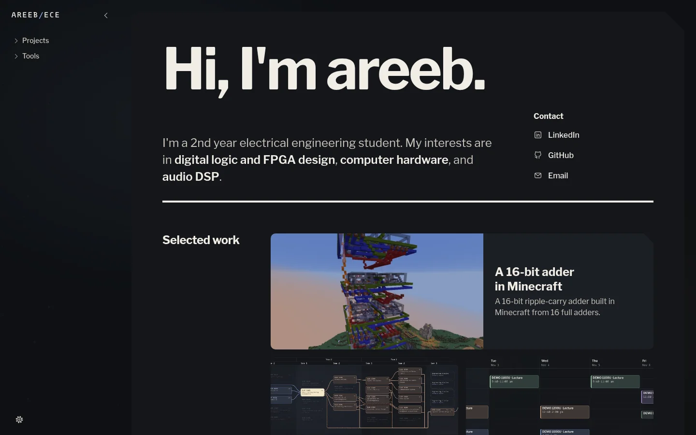

# areeb-ece.github.io

A personal portfolio site: a static Astro site built from Markdown pages and one YAML config.

**Live:** [areeb-ece.github.io](https://areeb-ece.github.io/)

## Table of Contents

- [About](#about)
- [Screenshots](#screenshots)
- [Features](#features)
- [Technologies](#technologies)
- [Setup](#setup)
- [Usage](#usage)
- [Project Status](#project-status)
- [Credits](#credits)
- [Author](#author)
- [License](#license)

## About

My portfolio: projects in digital logic, FPGA design, computer hardware and audio DSP, plus the small tools I've built. Every page is set like a component datasheet laid on a night sky.

I made it to show my work (projects and smaller tools, each with a banner, maths, code, timing diagrams and block diagrams where they help) and to stay easy to maintain: adding a page, a category, a link or a new intro is an edit to Markdown or to `site.config.yaml`, with no component code changes.

## Screenshots



## Features

- Pages are folders of Markdown with maths (KaTeX), syntax-highlighted code, and Mermaid and WaveDrom diagrams.
- Each page appears as its own Markdown being typed out, block by block, before it switches to the finished sheet.
- One shared palette with many themes and a settings panel, shared with the sibling tool sites.
- The result is plain HTML, CSS and a few kilobytes of JavaScript. Nothing is fetched at runtime and there are no trackers.
- Build checks: mistakes fail the build with the file and the problem, and CI runs unit tests and a browser check before anything is published.

### Typing animation

The pages are complete HTML. With JavaScript running, a small script hides each block (visually only; screen readers still get the whole page) and types its source in its place, all in one `requestAnimationFrame` loop over precomputed timestamps. A content page picks a speed of 600–1200 wpm and a 1–3 s budget on every load, and long pages speed up to fit, so no page takes longer than 3 s. The home title types at 100–250 wpm after the cursor blinks alone for a second, once per visit. Any click, key or scroll finishes it. With JavaScript off, `animate: false` or reduced motion, the page shows straight away. Every timing constant is in `src/client/timing.js`.

### Background

Three layers of stars from fixed seeds, drawn as tiling SVG patterns by `public/design/ui.js` (so PrereqFlow, OTU Calendar, Satisfactory Tools and Prayer Calendar get the same sky behind their sheets), drift over several minutes and follow a fraction of the scroll. The aurora glow sits behind them. Only transforms animate, the sky pauses in hidden tabs, and it holds still with reduced motion or with animations turned off. Star colours come from the theme. With the default settings, star brightness is capped so the dimmest text colour keeps WCAG AA contrast over any point of the sky, and the browser check measures it.

### Privacy

- **Strict Content Security Policy** on every page: scripts, styles, fonts and images only from this site, and `connect-src 'none'`. The one loosening is `style-src-attr 'unsafe-inline'`, because KaTeX and the code highlighter position and colour text with `style` attributes. Attributes can't run code, and `<style>` and `<script>` stay locked down.
- **No inline scripts.** `public/design/theme.js` and `public/js/boot.js` run before first paint as files. The other scripts are bundled modules, plus the shared `public/design/ui.js`, which builds its markup without `style` attributes so it also works under OTU Calendar's stricter policy.
- **Nothing external.** mononoki and KaTeX's fonts are self-hosted, there are no CDNs, no analytics and no third-party requests. The browser check asserts there are no CSP violations.

## Technologies

- TypeScript (build code, tests, scripts), JavaScript (browser scripts), Astro components, Markdown, CSS, YAML
- [Astro](https://astro.build) 7.3.8
- unified 11.0.5 with remark-parse 11.0.0, remark-gfm 4.0.1, remark-math 6.0.0, remark-directive 4.0.0, remark-rehype 11.1.2, rehype-katex 7.0.1, rehype-stringify 10.0.1
- KaTeX 0.19.0
- Shiki 4.5.0
- Mermaid 12.1.0
- WaveDrom 3.7.0
- yaml 2.9.1
- Dev and test: Playwright 1.56.1, @types/hast 3.0.5, @types/mdast 4.0.4, Node's built-in test runner (`node --test`)
- Node.js >=22.18.0 (CI uses Node 22 on ubuntu-24.04)

### How it's put together

```text
site.config.yaml          wordmark, home title + intro, contact links, fonts, reserved slugs
content/                  the pages: every folder with an index.md is a page (and a sidebar entry)
public/                   copied as-is: fonts (Libre Franklin, mononoki; OFL), contact icons, favicon, boot.js
src/lib/                  build code: config + frontmatter schemas, page tree, Markdown pipeline
src/lib/markdown/         unified pipeline, Shiki theme, KaTeX, Mermaid and WaveDrom renderers
src/client/               the browser scripts: typing animation (timing.js has every constant),
                          sidebar tree, copy buttons
public/design/            shared with PrereqFlow, OTU Calendar, Satisfactory Tools and Prayer Calendar: tokens.css (the master palette,
                          its themes and the shared type, spacing and motion scales), theme.js (applies
                          saved settings before paint), ui.js + ui.css (the settings button and panel,
                          the night sky, and the shared components), components.html (their reference),
                          fonts.css (the text face, Libre Franklin, for the tools)
src/styles/               the datasheet: shell, title blocks, plates, prose, code (tokens only)
src/pages/                routes: home, every content page, 404, generated fonts.css and
                          diagrams.css
scripts/new-page.ts       npm run new
tests/                    unit tests, fixtures and the Playwright browser check
```

#### Markdown

Each page goes through one [unified](https://unifiedjs.com) pipeline at build time: GFM (tables, task lists, footnotes), KaTeX maths, `::card` / `:::note` directives, Shiki syntax highlighting with a theme built from the site's colour tokens, and Mermaid and WaveDrom diagrams rendered to inline SVG. Every top-level block keeps its original Markdown, sliced from the file using the parser's positions, which is what the typing animation types before swapping in the rendered block.

Mistakes fail the build with the file and the problem: a card pointing at a page that doesn't exist, a misspelled frontmatter field, an image that isn't there, a folder name that can't be a web address. Maths and diagram syntax errors show up as a red box on the page instead, so one typo doesn't block a deploy.

#### One palette, many themes, six sites

`public/design/tokens.css` is the master palette: every colour, radius and shadow, as a set of themes, followed by the scales every site shares (type sizes, spacing, control heights, focus ring, motion durations and easing, layers, and colours mixed from each theme). `public/design/ui.css` holds the shared components (`sd-` buttons, fields, file drops, tables, cards, navigation, tabs, notes, tags, dialogs, toasts); each site opts in by class, and [`/design/components.html`](https://areeb-ece.github.io/design/components.html) shows them all in every state. The themes are Night, Paper, Void, Console, Amber, Arctic, Ocean, Forest, Retro, Solar dark and light, Synthwave, Ink, Sepia and Rosé. This site, [PrereqFlow](https://areeb-ece.github.io/prereqflow/), [OTU Calendar](https://areeb-ece.github.io/otucalendar/), [Satisfactory Tools](https://areeb-ece.github.io/satisfactorytools/), [Prayer Calendar](https://areeb-ece.github.io/PrayerCalendar/) and [Laplace Analyser](https://areeb-ece.github.io/LaplaceAnalyser/) all load it from `/design/tokens.css`, along with the rest of `public/design/` (they share the same address, so their security policies allow it). Edit it and push, and all six sites change when this one deploys. `npm test` checks every theme for missing colours and text contrast.

The gear icon on every site opens one settings panel (`public/design/ui.js`): theme (or follow the system's light/dark), accent colour, corners, motion, this site's typing effect, and the night sky. The settings live in one `localStorage` entry (`design.settings`), which the six sites share because they're on one origin, so a choice made on any of them applies to all of them, in later visits and in other open tabs. `public/design/theme.js` applies it before the first paint. Mermaid diagrams are drawn once at build time and their colours rewritten as CSS variables, so they follow the theme; code, WaveDrom and KaTeX already use the variables.

## Setup

### Prerequisites

- Node.js >=22.18.0
- Chromium from Playwright (needed to render Mermaid diagrams at build time)
- Firefox from Playwright, only if you run the browser check with `BROWSER=firefox`

### Install and run

```bash
git clone https://github.com/areeb-ece/areeb-ece.github.io.git
cd areeb-ece.github.io
npm install
npx playwright install chromium   # once: Mermaid diagrams are drawn in a headless browser at build time
npm run dev                       # http://localhost:4321, reloads as you edit
```

Live site: [areeb-ece.github.io](https://areeb-ece.github.io/)

### Tests and build

```bash
npm run new -- projects/my-new-thing "My New Thing"   # new page with commented frontmatter
npm test                                              # unit tests (node --test)
npm run build                                         # static site in dist/
npm run test:browser                                  # end-to-end check of dist/ in Chromium
BROWSER=firefox npm run test:browser                  # the same check in Firefox (npx playwright install firefox)
npm run check                                         # all three, the way CI runs them
```

### Deploying

Pushing to `main` runs the tests and the browser check (in Chromium and Firefox), builds the site and publishes it to GitHub Pages (`.github/workflows/deploy.yml`). Pull requests run the same checks without deploying. If a test fails, nothing is published.

## Usage

Each page is a folder under `content/` with an `index.md`. Its YAML frontmatter takes `title`, `description`, `order` and `bannerAlt`, plus optional `draft`, `hidden` and `font`. Images sit beside the page. Home title, intro, contact links, wordmark and fonts are set in `site.config.yaml`.

How to add a page, a category, a link or a new intro, with examples you can copy, is in [CONTENT_GUIDE.md](CONTENT_GUIDE.md). See also [ONBOARDING.md](ONBOARDING.md).

## Project Status

**Complete**, and still updated when something should be added or changed.

Next up: new projects and tools are added as they're made.

## Credits

- [Libre Franklin](https://github.com/googlefonts/Libre-Franklin) by the Libre Franklin Project Authors (Impallari Type), SIL Open Font License (`public/fonts/OFL-LibreFranklin.txt`), subset to Latin and weights 400–800
- [mononoki](https://github.com/madmalik/mononoki) by Matthias Tellen, SIL Open Font License (`public/fonts/OFL-mononoki.txt`)
- [Astro](https://astro.build), [unified](https://unifiedjs.com), [KaTeX](https://katex.org), [Shiki](https://shiki.style), [Mermaid](https://mermaid.js.org), [WaveDrom](https://wavedrom.com)
- The themes, settings panel and night sky began in [PrereqFlow](https://areeb-ece.github.io/prereqflow/) and [OTU Calendar](https://areeb-ece.github.io/otucalendar/)

## Author

Made by areeb ([areeb-ece.github.io](https://areeb-ece.github.io), [GitHub](https://github.com/areeb-ece)).

## License

MIT. See [LICENSE](LICENSE).
