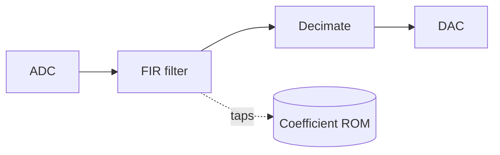
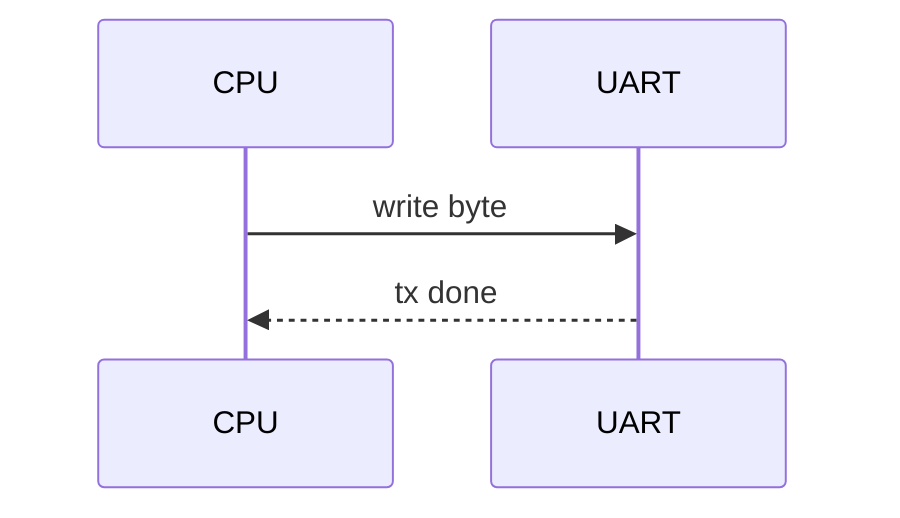

This page shows every Markdown feature the site supports, so changes to the styles can
be checked in one place. It is `hidden: true`, so it never appears in the sidebar or in
lists, but it is still built at `/_kitchen-sink/`.

## Text

Plain text with **bold**, *italic*, ***both***, ~~strikethrough~~, `inline code`, a
[link to the tools page](/tools/) and an autolink: https://areeb-ece.github.io.
Keyboard keys can use raw HTML: <kbd>Ctrl</kbd> + <kbd>C</kbd>. Times like 10:30 stay
as text.

A second paragraph with a footnote[^fn] and another one[^long].

### A third-level heading

#### A fourth-level heading

> A blockquote. It can hold **formatting** and span
> several lines.

---

## Lists

- An unordered item
- Another, with a nested list
  - nested one
  - nested two
- Back out

1. First
2. Second
3. Third

- [x] A finished task
- [ ] An open task

## Table

| Signal | Width | Direction | Notes |
| :----- | ----: | :-------: | ----- |
| `clk`  |     1 |    in     | 50 MHz board clock |
| `addr` |    16 |    out    | to the ROM |
| `data` |     8 |   inout   | shared bus |

## Images


An image without a caption, inline: 

## Math

Inline math like $V = IR$ or $\omega_0 = 1/\sqrt{LC}$ sits in the text.

$$
H(z) = \frac{\sum_{k=0}^{M} b_k z^{-k}}{1 + \sum_{k=1}^{N} a_k z^{-k}}
$$

A broken formula shows an error box instead of breaking the page:

$$
\frac{1}{2
$$

## Code

```verilog title="counter.v" {3,6-8}
module counter #(parameter N = 8) (
  input  wire         clk, rst,
  output reg  [N-1:0] q
);
  // count up on every rising edge
  always @(posedge clk)
    if (rst) q <= 0;
    else     q <= q + 1'b1;
endmodule
```

```systemverilog
module fifo_tb;
  logic clk = 0;
  always #5 clk = ~clk;
  initial begin
    $display("t=%0t", $time);
    #100 $finish;
  end
endmodule
```

```vhdl
library ieee;
use ieee.std_logic_1164.all;

entity blink is
  port (clk : in std_logic; led : out std_logic);
end entity;
```

```c
#include <stdint.h>
static inline uint16_t mac(int16_t a, int16_t b, uint16_t acc) {
    return acc + (uint16_t)(a * b) >> 8; /* fixed point */
}
```

```cpp
template <typename T>
T clamp(T x, T lo, T hi) { return x < lo ? lo : (x > hi ? hi : x); }
```

```python
import numpy as np
fs = 48_000
t = np.arange(fs) / fs
x = np.sin(2 * np.pi * 440 * t)  # A4
```

```matlab
fs = 48000;
[b, a] = butter(4, 1000/(fs/2));
y = filter(b, a, x);
```

```asm
loop:   addi  t0, t0, 1
        bne   t0, t1, loop
        ret
```

```tcl
create_clock -period 20.000 -name clk [get_ports clk]
set_property PACKAGE_PIN W5 [get_ports clk]
```

```bash
# build and program the board
yosys -p "synth_ice40 -json top.json" top.v
nextpnr-ice40 --up5k --json top.json --asc top.asc
```

```json
{ "name": "fpga-soft-cpu", "width": 8, "pipelined": false }
```

```yaml
board: iCEBreaker
clock_mhz: 12
pins: [clk, led_r, led_g]
```

```text
Plain text, no highlighting.
```

## Diagrams





```wavedrom
{ signal: [
  { name: 'clk',  wave: 'p.......' },
  { name: 'req',  wave: '01..0...' },
  { name: 'ack',  wave: '0..10...' },
  { name: 'data', wave: 'x.==.x..', data: ['D0', 'D1'] },
]}
```

A diagram with a mistake shows an error box:

```mermaid
flowchart LR
  A -->
```

## Callouts

:::note
A note. Use it for **context** or tips.
:::

:::warn[Heads up]
A warning with its own title.
:::

## Cards

A single card:

::card{to="/projects/fpga-soft-cpu"}

A group of cards:

:::cards
::card{to="/tools/prereqflow-notes"}
::card{to="/tools/otucalendar-notes"}
::card{to="/projects"}
:::

[^fn]: A short footnote.
[^long]: A longer footnote, with `code` and a [link](https://areeb-ece.github.io/prereqflow/).
