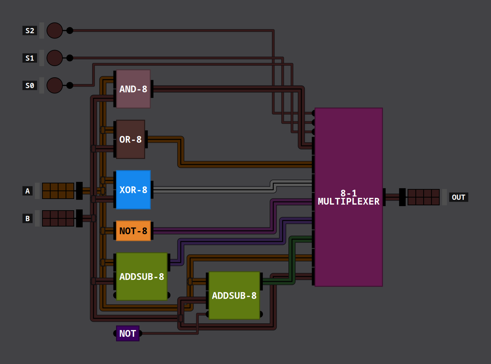
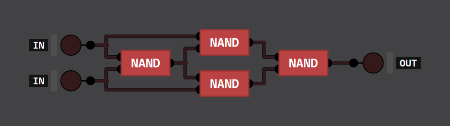
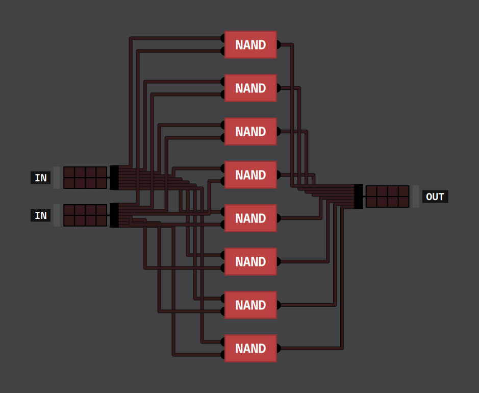
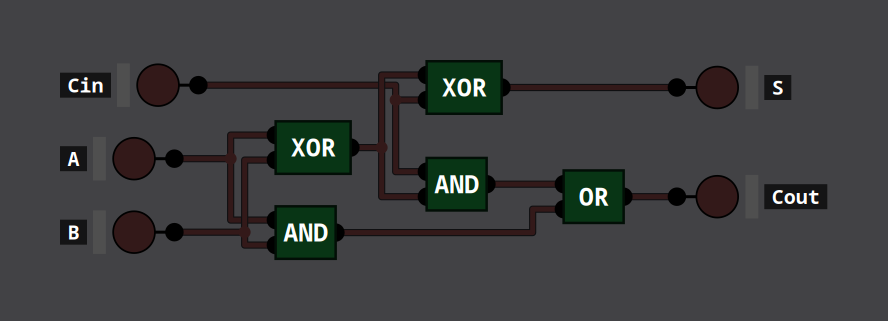
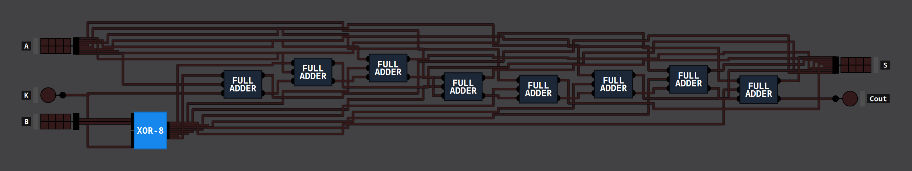
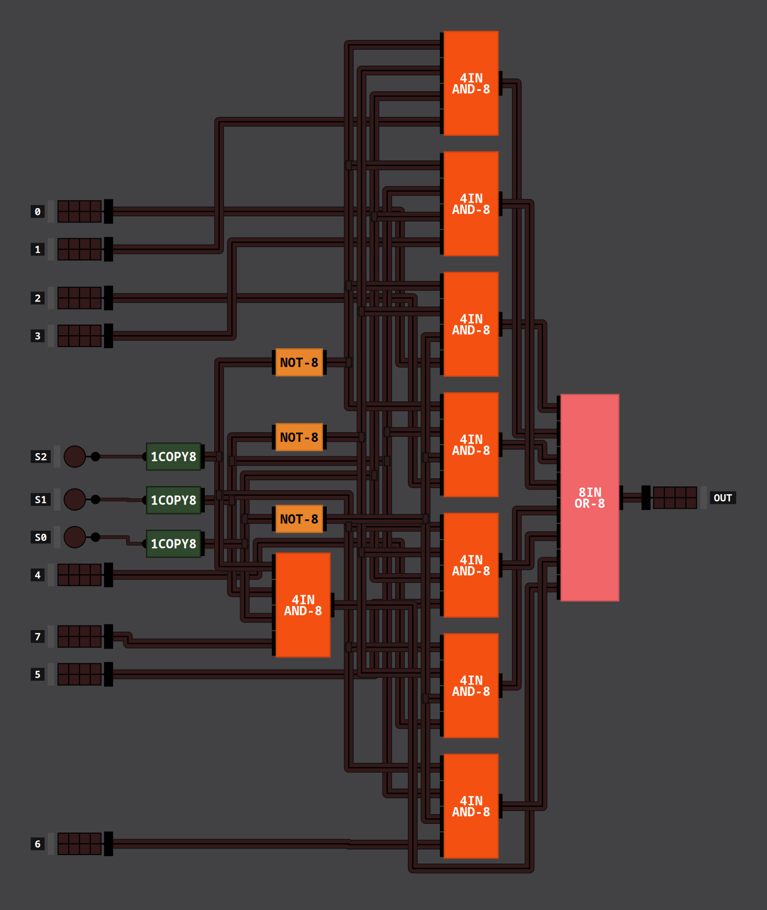

An 8-bit ALU (arithmetic logic unit) built in
[Digital Logic Sim](https://github.com/SebLague/Digital-Logic-Sim). It takes two 8-bit
numbers, $A$ and $B$, and a 3-bit select code $S_2S_1S_0$, and gives one 8-bit result.
Every part of it is built from NAND gates, 961 of them in total. The circuit pictures come
from my [DLS Image Exporter](/tools/dls-image-exporter/).

## Operations

| $S_2S_1S_0$ | Result |
| :-: | :-- |
| 000 | $A$ AND $B$ |
| 001 | $A$ OR $B$ |
| 010 | $A$ XOR $B$ |
| 011 | NOT $A$ |
| 100 | $A + B$ |
| 101 | $A - B$ |
| 110 | $A$ |
| 111 | $B$ |

The logic operations work on each bit on its own. Addition and subtraction keep the low 8
bits, so results wrap around: $200 + 100$ gives 44, and $3 - 5$ gives 254.

All the blocks work out their results at the same time. The select code only decides which
one is passed to the output.

## Gates from NAND

The only built-in gate the ALU uses is NAND. The rest are built from it:

| Gate | How it's built | NANDs |
| :-- | :-- | --: |
| NOT | a NAND with both inputs tied together | 1 |
| AND | a NAND followed by a NOT | 2 |
| OR | NOT each input, then NAND them: $A + B = \overline{\overline{A}\,\overline{B}}$ | 3 |
| XOR | the four-NAND circuit below | 4 |

The 8-bit versions (AND-8, OR-8, XOR-8 and NOT-8) are the same circuits, built from NAND-8.
NAND-8 splits its two inputs into single bits and uses eight NANDs side by side, one per
bit.

## Adding and subtracting

A full adder adds one column: two bits and a carry-in. The sum bit is
$A \oplus B \oplus C_{in}$, and the carry-out is 1 when at least two of the three inputs
are 1. My [Minecraft adder](/projects/minecraft-adder/) page goes through it step by step.

ADDSUB-8 chains eight full adders, each carry-out feeding the next carry-in, and adds a
control input $K$:

- Every bit of $B$ goes through an XOR with $K$ before it reaches the adders.
- $K$ is also the carry-in of the first adder.

With $K = 0$, $B$ passes through unchanged and the circuit adds. With $K = 1$, every bit of
$B$ is flipped and 1 is added through the carry-in. In two's complement, flipping the bits
and adding 1 negates a number, so the result is $A - B$:

$$
A + \overline{B} + 1 = A - B
$$

The ALU uses two ADDSUB-8s. One has nothing connected to $K$, which reads as 0, so it
always adds. The other gets $K$ from a NOT gate with nothing on its input, which gives a
constant 1, so it always subtracts.

## Picking the result: the multiplexer

The 8-to-1 multiplexer has eight 8-bit inputs, numbered 0 to 7, and passes through the one
whose number matches $S_2S_1S_0$.

- 1COPY8 copies a select bit onto all 8 wires of a bus, and NOT-8 makes an inverted copy.
- Each input has its own 4IN AND-8, an AND of four 8-bit buses. It ANDs the input with
  three select buses, using the plain or inverted version of each select bit so that all
  three are 1 only for that input's number. Input 5 (101), for example, uses $S_2$,
  $\overline{S_1}$ and $S_0$.
- Only the matching AND lets its data through; the other seven output 0. 8IN OR-8 then ORs
  all eight together, which leaves just the selected input.

4IN AND-8 is three AND-8s in a tree, and 8IN OR-8 is seven OR-8s in a tree.

## The critical path

The critical path is the slowest route from an input to an output. It sets how long the
result takes to settle after the inputs change. Counting each NAND as one gate delay, the
longest path from $A$ or $B$ to the output through each operation is:

| Operation | Gate delays |
| :-- | --: |
| pass $A$ or $B$ | 10 |
| NOT | 11 |
| AND, OR | 12 |
| XOR | 13 |
| add, subtract | 47 |

The multiplexer accounts for 10 of these delays in every row. Changing the select code
takes 11 delays to reach the output.

The 47-delay path goes from bit 0 of $B$ to bit 7 of the output:

1. XOR-8 (flipping $B$): 3
2. The first full adder's carry-out: 7
3. Six more carries, 4 each: 24
4. The XOR that makes bit 7 of the sum: 3
5. The multiplexer: 10

The carry has to ripple through the adders one at a time, so the longest path to each
output bit is 4 delays longer than to the bit below it. The adder that only adds is just as
slow, because its $B$ still goes through the XOR-8, with $K = 0$.

## Follow-up: Verilog and VHDL

As a follow-up to this project, I plan to build the ALU in Verilog and VHDL and look at its
critical timing paths there.

## The whole ALU, expanded

