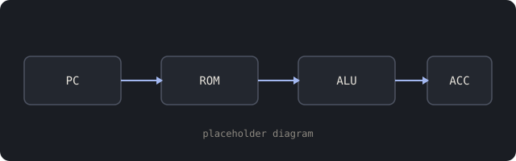
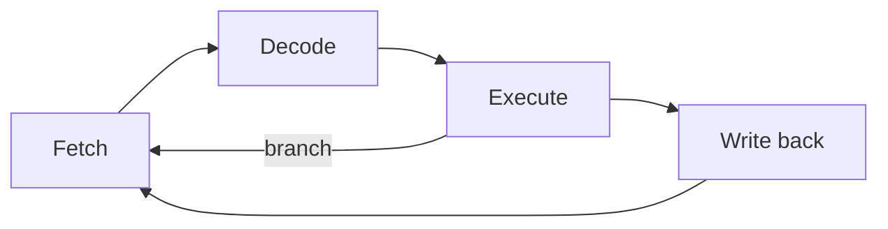

:::warn[Example page]
Everything on this page is placeholder text that shows what a project page can hold.
Replace it with a real project, or delete the `content/projects/fpga-soft-cpu/` folder.
:::

## Overview

A short summary of the project goes here: what it is, what you built it on, and what
you learned. This example pretends to be a small accumulator CPU on an FPGA.



## The maths

The ALU adds with a ripple-carry chain. For an $n$-bit adder the worst-case delay is

$$
t_{\text{add}} = t_{\text{setup}} + n \cdot t_{\text{carry}} + t_{\text{sum}}
$$

so the maximum clock frequency is roughly $f_{\max} \approx 1 / t_{\text{add}}$.

## The datapath

```verilog title="alu.v" {4-6}
module alu #(parameter W = 8) (
  input  wire [W-1:0] a, b,
  input  wire [1:0]   op,
  output reg  [W-1:0] y
);
  always @* case (op)
    2'b00: y = a + b;
    2'b01: y = a - b;
    2'b10: y = a & b;
    default: y = a | b;
  endcase
endmodule
```

## Timing

```wavedrom
{ "signal": [
  { "name": "clk",   "wave": "p......" },
  { "name": "fetch", "wave": "010..10" },
  { "name": "pc",    "wave": "x=.=..=", "data": ["0", "1", "2"] },
  { "name": "acc",   "wave": "x..=..=", "data": ["A", "B"] }
]}
```

## Control flow



## Related

::card{to="/tools/prereqflow-notes"}
