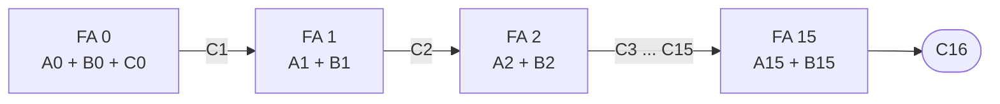
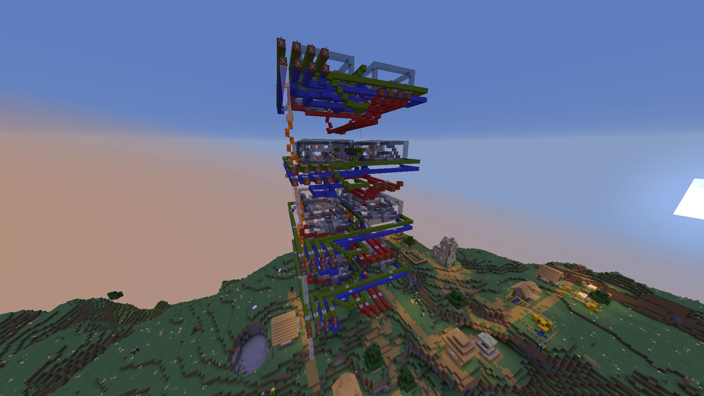

**Video: [youtu.be/2WGSphOPp9c](https://youtu.be/2WGSphOPp9c)**

A 16-bit adder built in Minecraft: 16 full adders in sequence, each passing its carry to
the next. It adds two numbers from 0 to 65,535.

## Adding in binary

Binary addition works like the column addition taught in school, except a column
overflows at 2 instead of 10. Each column adds two bits plus the carry from the column to
its right, writes down one bit and carries the other. For example, $6 + 7 = 13$:

| | bit 3 | bit 2 | bit 1 | bit 0 |
| :--- | :-: | :-: | :-: | :-: |
| carry in | 1 | 1 | 0 | 0 |
| $A = 6$ | 0 | 1 | 1 | 0 |
| $B = 7$ | 0 | 1 | 1 | 1 |
| sum $= 13$ | 1 | 1 | 0 | 1 |

So one circuit that adds a single column, three bits in and two bits out, is all an adder
needs. Copy it once per bit and chain the carries.

## The full adder

A full adder is that one-column circuit. It takes the two bits $A$ and $B$ and a carry-in
$C_{in}$, and gives a sum bit $S$ and a carry-out $C_{out}$:

| $A$ | $B$ | $C_{in}$ | $S$ | $C_{out}$ |
| :-: | :-: | :-: | :-: | :-: |
| 0 | 0 | 0 | 0 | 0 |
| 0 | 0 | 1 | 1 | 0 |
| 0 | 1 | 0 | 1 | 0 |
| 0 | 1 | 1 | 0 | 1 |
| 1 | 0 | 0 | 1 | 0 |
| 1 | 0 | 1 | 0 | 1 |
| 1 | 1 | 0 | 0 | 1 |
| 1 | 1 | 1 | 1 | 1 |

$S$ is 1 when an odd number of the inputs are 1, which is what XOR computes. $C_{out}$ is 1
when at least two of them are:

$$
S = A \oplus B \oplus C_{in}, \qquad C_{out} = AB + C_{in}\,(A \oplus B)
$$

The carry reads as: carry out if $A$ and $B$ are both 1, or if exactly one of them is
and there's a carry coming in. That makes five gates: two XORs for the sum, and two ANDs
and an OR for the carry. The first XOR, $A \oplus B$, is shared by both outputs.

.")

## Sixteen in a row

Chaining 16 full adders, each carry-out wired to the next adder's carry-in, gives a 16-bit
ripple-carry adder. Adder $i$ adds bit $i$ of each number, $A_i$ and $B_i$, and the carry
$C_i$ from the bit below. For a plain addition the first carry-in, $C_0$, is 0.

The catch is in the name: the carry *ripples*. Bit 15 can't settle until the carry from
bit 14 has arrived, which waits on bit 13, and so on down to bit 0. The worst case is a
carry that has to travel the whole way, such as

$$
\underbrace{1111\,1111\,1111\,1111_2}_{65{,}535} + 1 = \underbrace{1\;0000\,0000\,0000\,0000_2}_{65{,}536}
$$

where the carry starts at bit 0 and has to pass through all 16 adders before the top bits
are right. The time an addition takes grows with the number of bits. In Minecraft every
gate takes game ticks to switch, so the ripple is slow enough to see. Faster adders
(carry-lookahead) work out the carries in parallel, at the cost of many more gates.

The largest sum, $65{,}535 + 65{,}535 = 131{,}070$, needs 17 bits, so the last carry-out,
$C_{16}$, is the sum's 17th bit.

