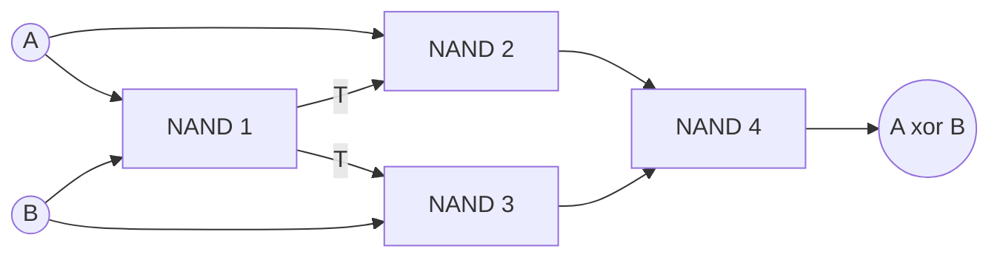
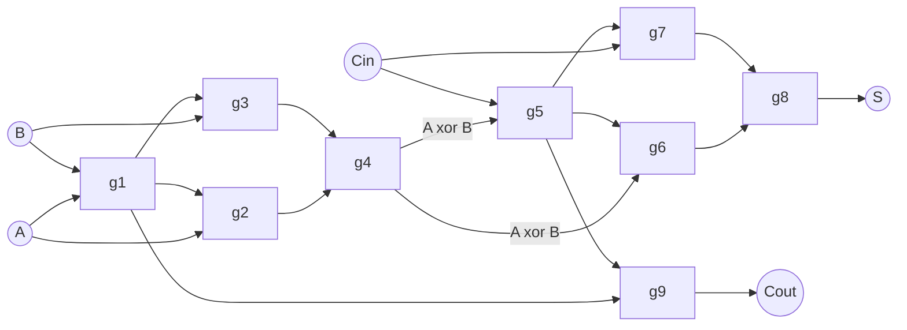
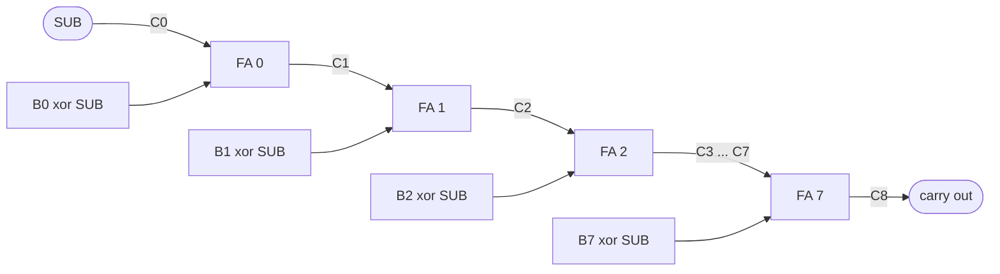
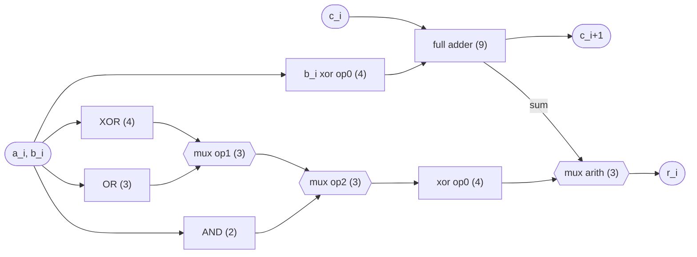
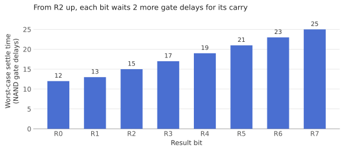

This page builds an 8-bit arithmetic logic unit (ALU) out of one gate type only: the
two-input NAND. Every inverter, adder and multiplexer below is a handful of NANDs wired
together, and the finished design is 310 of them.

| Spec | |
| :--- | :--- |
| Operands | `A`, `B`: 8 bits each |
| Operations | ADD, SUB, AND, NAND, OR, NOR, XOR, XNOR (3-bit opcode) |
| Flags | Z (zero), N (negative), C (carry), V (signed overflow) |
| Size | 310 two-input NAND gates (about 1,240 transistors in static CMOS) |
| Critical path | 25 NAND delays to the result, 32 to the Z flag |

:::note[How it was checked]
The design was checked with a gate-level model in which every gate is a NAND. All 8
operations were run on all 65,536 operand pairs (524,288 cases), comparing the result
and every flag against ordinary integer arithmetic, with no mismatches. The structural
Verilog below flattens to the same 310 NANDs and passes the same exhaustive test.
:::

## Why NAND is enough

A gate type is *functionally complete* if any Boolean function can be built from it
alone. NAND is, because it gives you NOT and AND, and De Morgan's law turns those into OR:

$$
\begin{aligned}
\overline{A} &= \overline{A \cdot A} \\
A \cdot B &= \overline{\overline{A \cdot B}} \\
A + B &= \overline{\overline{A} \cdot \overline{B}}
\end{aligned}
$$

Once AND, OR and NOT exist, every truth table can be written as a sum of products, so
everything else follows. In practice you want the cheapest NAND form of each building
block, since every gate costs area and every level costs delay:

| Block | Built as | NANDs | Levels |
| :--- | :--- | ---: | ---: |
| NOT | `nand(a, a)` | 1 | 1 |
| AND | NOT of a NAND | 2 | 2 |
| OR | NAND of the two inverted inputs | 3 | 2 |
| XOR | the four-gate form below | 4 | 3 |
| 2:1 MUX | `nand(nand(d0, ~s), nand(d1, s))` | 3 (+1 shared) | 2 |

### XOR in four gates

XOR is the gate an adder needs most, so its four-NAND form is worth deriving. Let
$T = \overline{AB}$, the first gate's output. Feeding $T$ into two more NANDs gives

$$
\begin{aligned}
\overline{A \cdot T} &= \overline{A(\overline{A} + \overline{B})} = \overline{A\overline{B}} \\
\overline{B \cdot T} &= \overline{B(\overline{A} + \overline{B})} = \overline{\overline{A}B}
\end{aligned}
$$

and a final NAND of those two is $A\overline{B} + \overline{A}B = A \oplus B$.



## The full adder: 9 NANDs

A full adder adds two bits and a carry-in:

| $A$ | $B$ | $C_{in}$ | $S$ | $C_{out}$ |
| :-: | :-: | :-: | :-: | :-: |
| 0 | 0 | 0 | 0 | 0 |
| 0 | 0 | 1 | 1 | 0 |
| 0 | 1 | 0 | 1 | 0 |
| 0 | 1 | 1 | 0 | 1 |
| 1 | 0 | 0 | 1 | 0 |
| 1 | 0 | 1 | 0 | 1 |
| 1 | 1 | 0 | 0 | 1 |
| 1 | 1 | 1 | 1 | 1 |

$$
S = A \oplus B \oplus C_{in}, \qquad C_{out} = AB + C_{in}(A \oplus B)
$$

The cheap version chains two of the four-gate XORs and builds the carry from gates that
are already there. The first XOR's input gate $n_1 = \overline{AB}$ and the second XOR's
input gate $n_5 = \overline{(A \oplus B)\,C_{in}}$ are exactly the two terms of
$C_{out}$, inverted, so one more NAND finishes it:

$$
\overline{n_1 \cdot n_5} = AB + (A \oplus B)\,C_{in} = C_{out}
$$



What matters for speed is how long each output takes after each input changes:

| From → to | NAND delays | Path |
| :--- | ---: | :--- |
| $C_{in} \to C_{out}$ | 2 | g5, g9 |
| $C_{in} \to S$ | 3 | g5, g6, g8 |
| $A, B \to C_{out}$ | 5 | g1, g2, g4, g5, g9 |
| $A, B \to S$ | 6 | g1, g2, g4, g5, g6, g8 |

The carry-in to carry-out path is only two gates long. That is what makes the next step
reasonably quick.

## Eight bits: adding and subtracting

Chaining eight full adders, each carry-out feeding the next carry-in, gives a ripple-carry
adder. Subtraction comes almost free from two's complement:

$$
A - B = A + \overline{B} + 1
$$

So each $B_i$ passes through an XOR with a `SUB` signal (which inverts it when `SUB = 1`),
and `SUB` also drives the first carry-in, supplying the $+1$.



Each bit costs 4 NANDs for the XOR and 9 for the adder, so the adder/subtractor is
$8 \times 13 = 104$ gates. The first carry-out settles 8 gate delays after the inputs
change (3 through the XOR, 5 through the adder). After that each stage adds 2:

$$
t(C_i) = 2i + 6 \quad (i \ge 1), \qquad t(C_8) = 22
$$

## The logic unit

The logic operations work bit by bit, with no carries, so each bit just computes all
three in parallel:

| Function | NANDs per bit | For 8 bits |
| :--- | ---: | ---: |
| $A_i \cdot B_i$ | 2 | 16 |
| $A_i + B_i$ | 3 | 24 |
| $A_i \oplus B_i$ | 4 | 32 |

The inverted versions (NAND, NOR, XNOR) cost no extra units: one conditional inverter at
the end of the logic path handles all three.

## Choosing the operation

The opcode is three bits. `op[2:1]` picks the unit and `op[0]` means "invert": for the
arithmetic unit that is `SUB` (invert $B$), and for the logic unit it inverts the result.

| `op[2:0]` | Operation | Result |
| :-: | :--- | :--- |
| `000` | ADD | $A + B$ |
| `001` | SUB | $A - B$ |
| `010` | AND | $A \cdot B$ |
| `011` | NAND | $\overline{A \cdot B}$ |
| `100` | OR | $A + B$ (bitwise) |
| `101` | NOR | $\overline{A + B}$ |
| `110` | XOR | $A \oplus B$ |
| `111` | XNOR | $\overline{A \oplus B}$ |

Each result bit goes through three 2:1 multiplexers and the inverter:

1. `op[1]` picks OR or XOR.
2. `op[2]` picks AND or that result.
3. An XOR with `op[0]` inverts it for NAND, NOR and XNOR.
4. `arith` picks the adder's sum or the logic result.

The control signals are decoded once and shared by all eight bits: $\overline{op_1}$ and
$\overline{op_2}$ (one NAND each), `logic` $= op_2 + op_1 = \overline{\overline{op_2}\,\overline{op_1}}$ (one NAND) and
`arith` $= \overline{\text{logic}}$ (one NAND). That is 4 gates in total, and each mux
gets its inverted select for free.



One bit slice is $4 + 9 + 2 + 3 + 4 + 3 + 3 + 4 + 3 = 35$ NANDs. The numbers in
brackets in the diagram are each block's gate count.

## Flags

| Flag | Meaning | Logic | NANDs |
| :-: | :--- | :--- | ---: |
| Z | result is zero | $\overline{R_0 + R_1 + \dots + R_7}$: invert each bit, then an AND tree | 22 |
| N | result is negative (signed) | $R_7$, a wire | 0 |
| C | carry out of bit 7 | $C_8$, a wire | 0 |
| V | signed overflow | $C_7 \oplus C_8$ | 4 |

Z and N mean something for every operation. C and V are only meaningful for ADD and SUB.
When subtracting, $C = 1$ means *no* borrow, that is $A \ge B$ as unsigned numbers.

Signed overflow happens when the carry *into* the sign bit differs from the carry *out*
of it. That is exactly when two numbers with the same sign produce a result with the
other sign. Two worked examples:

| Operation | Bits | Result | C | V | N | Reading |
| :--- | :--- | :--- | :-: | :-: | :-: | :--- |
| $100 + 50$ | `01100100 + 00110010` | `10010110` | 0 | 1 | 1 | 150 unsigned is right; as signed it wrapped to −106 |
| $50 - 100$ | `00110010 + 10011011 + 1` | `11001110` | 0 | 0 | 1 | −50 signed is right; C = 0 flags the unsigned borrow |

## Gate count

| Block | Per bit | Total |
| :--- | ---: | ---: |
| Control decode (shared) | | 4 |
| B xor SUB | 4 | 32 |
| Full adders | 9 | 72 |
| AND, OR, XOR | 9 | 72 |
| Three 2:1 muxes | 9 | 72 |
| Result inverter (xor op0) | 4 | 32 |
| Flags (Z 22, V 4) | | 26 |
| **Total** | **35** | **310** |

For an $n$-bit version of the same design the count is $38n + 6$, so it grows linearly
with width.

## Timing

Counting every NAND as one delay, the worst path runs from `op[0]` through the first
B-inverting XOR, all the way up the carry chain to $C_7$ (20), through the last adder's
sum (23) and the final mux (25). For $n$ bits the ripple makes this $2n + 9$.



The same numbers as a timing diagram, one tick per NAND delay after the inputs change.
Each signal is unknown (hatched) until it settles:

```wavedrom
{ signal: [
  { name: 'A, B, op', wave: '=.................................', data: ['new inputs'] },
  {},
  { name: 'C1', wave: 'x.......=.........................', data: ['C1'] },
  { name: 'C4', wave: 'x.............=...................', data: ['C4'] },
  { name: 'C8', wave: 'x.....................=...........', data: ['C8'] },
  {},
  { name: 'R0', wave: 'x...........=.....................', data: ['R0'] },
  { name: 'R7', wave: 'x........................=........', data: ['R7'] },
  { name: 'Z',  wave: 'x...............................=.', data: ['Z'] },
],
  head: { text: 'NAND gate delays after the inputs change', tick: 0, every: 2 },
}
```

If one NAND delay were 10 ns, a result would take 250 ns to settle, so a clocked design
around this ALU could run at about 4 MHz at most. Nearly all of that time is the carry
rippling up the chain. A carry-lookahead adder computes the carries in parallel instead,
trading more gates for a delay that grows with $\log n$ rather than $n$.

## In Verilog

The same circuit in structural Verilog, using only the `nand` primitive. The small
modules are named groups of NANDs; the eight bit slices are lines 46–57.

```verilog title="alu8.v" {46-57}
// Every gate below is a 2-input NAND. The small modules are just named groups of them.
module inv  (input a, output y);    nand g(y, a, a); endmodule
module and2 (input a, b, output y); wire t; nand g1(t, a, b); nand g2(y, t, t); endmodule
module or2  (input a, b, output y);
  wire na, nb;
  nand g1(na, a, a); nand g2(nb, b, b); nand g3(y, na, nb);
endmodule
module xor2 (input a, b, output y);
  wire t, u, w;
  nand g1(t, a, b); nand g2(u, a, t); nand g3(w, b, t); nand g4(y, u, w);
endmodule
// y = s ? d1 : d0. ns is ~s, shared by all eight bits.
module mux2 (input d0, d1, s, ns, output y);
  wire u, w;
  nand g1(u, d0, ns); nand g2(w, d1, s); nand g3(y, u, w);
endmodule

module full_adder (input a, b, cin, output s, cout);
  wire n1, n2, n3, x, n5, n6, n7;
  nand g1(n1, a, b);
  nand g2(n2, a, n1);
  nand g3(n3, b, n1);
  nand g4(x, n2, n3);     // a ^ b
  nand g5(n5, x, cin);
  nand g6(n6, x, n5);
  nand g7(n7, cin, n5);
  nand g8(s, n6, n7);     // a ^ b ^ cin
  nand g9(cout, n1, n5);  // ab + cin(a ^ b)
endmodule

module alu8 (
  input  [7:0] a, b,
  input  [2:0] op,        // op[2:1]: 00 add/sub, 01 and, 10 or, 11 xor; op[0]: sub / invert
  output [7:0] r,
  output z, n, c, v
);
  wire nop1, nop2, is_logic, is_arith;
  inv  d1(op[1], nop1);
  inv  d2(op[2], nop2);
  nand d3(is_logic, nop1, nop2);   // op[2] | op[1]
  inv  d4(is_logic, is_arith);

  wire [8:0] cy;
  assign cy[0] = op[0];            // carry-in is 1 when subtracting
  genvar i;
  generate for (i = 0; i < 8; i = i + 1) begin : slice
    wire bx, s, f_and, f_or, f_xor, m1, l, li;
    xor2       bxor (b[i], op[0], bx);        // B or ~B
    full_adder fa   (a[i], bx, cy[i], s, cy[i+1]);
    and2       ua   (a[i], b[i], f_and);
    or2        uo   (a[i], b[i], f_or);
    xor2       ux   (a[i], b[i], f_xor);
    mux2       m_ox (f_or, f_xor, op[1], nop1, m1);
    mux2       m_l  (f_and, m1, op[2], nop2, l);
    xor2       linv (l, op[0], li);           // NAND, NOR, XNOR
    mux2       m_r  (li, s, is_arith, is_logic, r[i]);
  end endgenerate

  // Z: invert every result bit, then AND them together in a tree.
  wire [7:0] nr;
  wire [3:0] z1;
  wire [1:0] z2;
  generate for (i = 0; i < 8; i = i + 1) begin : zinv
    inv g (r[i], nr[i]);
  end endgenerate
  generate for (i = 0; i < 4; i = i + 1) begin : zand
    and2 g (nr[2*i], nr[2*i+1], z1[i]);
  end endgenerate
  and2 z2a (z1[0], z1[1], z2[0]);
  and2 z2b (z1[2], z1[3], z2[1]);
  and2 z3  (z2[0], z2[1], z);

  assign n = r[7];                 // sign
  assign c = cy[8];                // carry out (1 = no borrow when subtracting)
  xor2 ov (cy[7], cy[8], v);       // signed overflow
endmodule
```

An exhaustive testbench. It tries every opcode on every pair of operands and counts the
mismatches against Verilog's own operators:

```verilog title="alu8_tb.v"
module alu8_tb;
  reg  [7:0] a, b, expected;
  reg  [2:0] op;
  wire [7:0] r;
  wire z, n, c, v;
  integer k, ai, bi, errors = 0;

  alu8 dut(a, b, op, r, z, n, c, v);

  initial begin
    for (k = 0; k < 8; k = k + 1)
      for (ai = 0; ai < 256; ai = ai + 1)
        for (bi = 0; bi < 256; bi = bi + 1) begin
          op = k; a = ai; b = bi; #1;
          case (op)
            3'd0: expected = a + b;     3'd1: expected = a - b;
            3'd2: expected = a & b;     3'd3: expected = ~(a & b);
            3'd4: expected = a | b;     3'd5: expected = ~(a | b);
            3'd6: expected = a ^ b;     default: expected = ~(a ^ b);
          endcase
          if (r !== expected || z !== (expected == 0) || n !== expected[7])
            errors = errors + 1;
        end
    $display("%0d mismatches in 524288 cases", errors);
    $finish;
  end
endmodule
```

```bash
iverilog -o alu8_tb alu8.v alu8_tb.v && vvp alu8_tb
```
